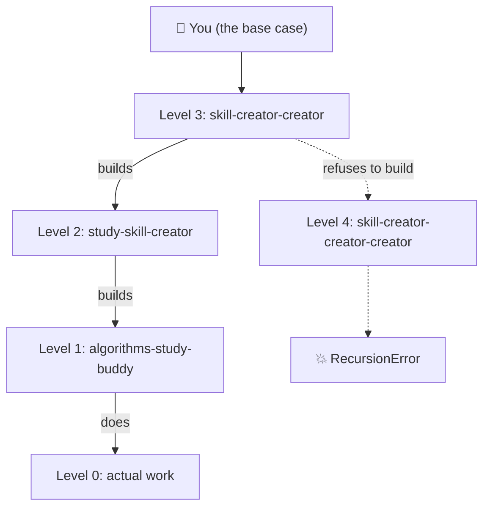

# skill-creator-creator

A Claude skill that creates skills that create skills.

> Recursion, but for homework you give an AI.

It started as a workshop joke. Then it turned out to work.

## The idea in one picture



## Explain it like I'm five

- 🍪 A **skill** is a recipe. It tells Claude how to bake one kind of cookie.
- 📚 A **skill creator** is a chef who writes recipes.
- 🏫 A **skill creator creator** is a cooking school that trains chefs.

There is no school for building cooking schools. At some point, somebody has to be hungry.

## What it does

A skill is a text file that teaches Claude one job. Claude already ships with `skill-creator`, which writes one skill at a time for any topic.

This skill goes one level up. It builds **your own skill creator for one domain**. That creator then produces many skills of the same shape.

| Level | What it is | Example | Useful when |
|---|---|---|---|
| 0 | Claude does the task | "Explain Dijkstra" | You need it once |
| 1 | A skill | `algorithms-study-buddy` | You need it every week |
| 2 | A skill creator | `study-skill-creator` | You need one skill per course, per team, per client |
| 3 | A skill creator creator | this repo | You need to build Level 2 for a new domain |
| 4 | No | `skill-creator-creator-creator` | Never |

### What happens when you use it

1. **It tries to talk you out of it.** Most people who ask for a skill factory need one skill. The skill checks three things: do you need five or more skills, do they share a shape, and will someone else make them? If not, it offers to write the one skill instead.
2. **It interviews you.** Five questions: the domain, who runs the creator, who uses the output, what every produced skill must contain, and what a bad one looks like.
3. **It writes your skill creator.** The result has seven fixed parts: scope, interview questions, a fill-in template, filling rules, a quality checklist, test prompts, and naming.
4. **It proves the machine works.** It runs your new creator once, produces a real skill, and checks that skill against the creator's own checklist. A bad product means it fixes the machine.
5. **It hands over and stops.** You get the creator, one sample skill, and a four-line usage note.

### The base case

Ask it for a Level 4 skill and you get this:

```
RecursionError: maximum skill depth exceeded.
Base case: you.
```

The reason is real. Each level up removes detail about the actual work. At Level 4 there is nothing left to ask about, so the output is empty. Skills are useful because a person wanted something specific. That person is the base case.

## See the whole chain

The `examples/` folder holds a real chain, top to bottom:

| File | Level | Made by |
|---|---|---|
| `SKILL.md` | 3 | A human and Claude, laughing |
| `examples/level-2-study-skill-creator/SKILL.md` | 2 | skill-creator-creator |
| `examples/level-1-algorithms-study-buddy/SKILL.md` | 1 | study-skill-creator |

Read them in that order. Each file is the template of the one above it, filled in.

## Install

### Claude app (web or desktop)

1. Tap **Code → Download ZIP** on this page.
2. In Claude, open your skills settings and upload the ZIP as a skill.
3. Start a new chat.

### Claude Code

```bash
mkdir -p ~/.claude/skills
git clone https://github.com/YsuLab/skill-creator-creator ~/.claude/skills/skill-creator-creator
```

## Try it

A real request:

```
Use skill-creator-creator. I run a programming club, and I want every member to be able to make a study skill for their own course.
```

The base case:

```
Use skill-creator-creator to make a skill-creator-creator-creator.
```

## The depth checker

A small script tells you how deep a skill name goes.

```bash
$ python3 scripts/check_depth.py algorithms-study-buddy
algorithms-study-buddy: Level 1, a skill. It does actual work. Respect.

$ python3 scripts/check_depth.py study-skill-creator
study-skill-creator: Level 2, a skill creator. It makes skills. Reasonable.

$ python3 scripts/check_depth.py skill-creator-creator-creator
skill-creator-creator-creator: Level 4

RecursionError: maximum skill depth exceeded.
Base case: you.
```

It exits with code 1 at Level 4, so you can put it in CI. Please do not put it in CI.

## FAQ

**Is this a joke?**
Yes.

**Does it work?**
Also yes.

**When is Level 2 worth it?**
When a group writes many similar skills. A club where each member wants a study skill for a different course is a good case. So is a team that wants one runbook skill per service.

**Should I use this instead of skill-creator?**
Almost never. If you want one skill, use `skill-creator`. This skill will tell you the same thing.

**Who created the skill-creator-creator?**
A skill creator. We don't talk about it.

**Can I make a skill-creator-creator-creator?**
`RecursionError: maximum skill depth exceeded.`

## Credits

Built for a workshop on Claude skills. The companion skill is [readable-replies](https://github.com/YsuLab/readable-replies), which is why this README is easy to read.
